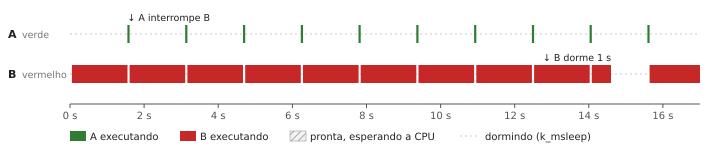
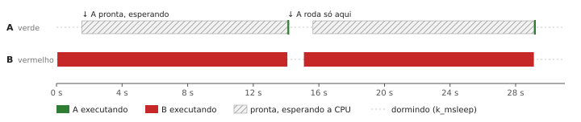
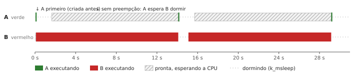
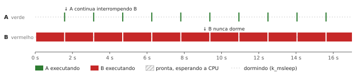
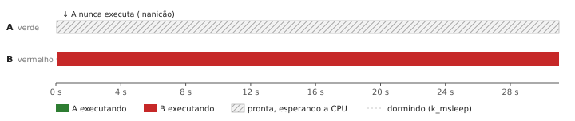
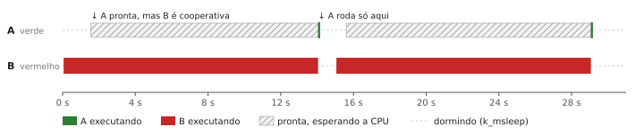

# Atividade — Threads e Prioridades

**Placa:** FRDM-KL25Z · **Zephyr:** 4.2 · **Branch:** `prioridades` · **Código:** [`src/main.c`](src/main.c)

O código base da atividade (commit `prioridades: código base fornecido...`) foi instrumentado com:

- medição de tempo com o contador do SysTick (`k_cycle_get_32()`, 48 MHz, 1 ciclo ≈ 20,8 ns) e com `k_uptime_get_32()` (ms);
- 6 casos de prioridade e `k_msleep()`, escolhidos pela macro `CASO` no início do arquivo;
- um botão (SW0, PTA16) com interrupção, que inverte o LED azul e registra qual thread foi interrompida;
- Logging (`LOG_INF`) no lugar de `printk`, com tempos intermediários da thread B.

| LED | Thread | Prioridade padrão | Trabalho por ciclo | Dorme |
|---|---|---|---|---|
| Verde (`led0`) | A | 5 | laço de 200 000 iterações | 1500 ms |
| Vermelho (`led2`) | B | 7 | laço de 10 000 000 iterações | 1000 ms |
| Azul (`led1`) | ISR do botão | acima de qualquer thread | inverte o LED | — |

> No Zephyr, **número menor = prioridade maior**. Prioridades negativas são **cooperativas**.

---

## 1. Medição com o SysTick e diagramas temporais

**Como foi medido.** Cada thread lê `k_cycle_get_32()` ao acender o LED e de novo ao apagar. A diferença, convertida com `k_cyc_to_us_floor32()`, é a **duração de parede** do trabalho: inclui o tempo em que a thread ficou parada esperando outra de prioridade maior. Por isso, comparar a duração de um caso para o outro mostra a preempção. O `k_uptime_get_32()` dá os instantes de início e fim em ms, usados para desenhar os diagramas.

**Tempos medidos na placa** (logs completos em [`logs/`](logs/)):

| Caso | Duração de A | Duração de B | A interrompeu B? | Período real de A |
|---|---|---|---|---|
| 1 — A 5, B 7 | 50,08 ms | 14,55 s | **Sim**, 9 vezes por ciclo de B | **1559 ms** (pontual) |
| 2 — A 7, B 5 | 50,08 ms | 14,02 s | **Não** | **≈ 15,03 s** — A só roda quando B dorme |
| 5 — A 7, B 5, B sem sono | — (nunca executou) | 13,94 s | **Não** | **A nunca executa** (inanição) |
| 6 — A 5, B coop. (-1) | 50,08 ms | 14,00 s | **Não** | **≈ 15,0 s** — A só roda quando B cede a CPU |
| 3 e 4 | não executados na placa | | | ver previsão nos diagramas |

**O que os números mostram:**

- **A sempre leva 50,08 ms** quando executa (variação < 20 µs). O trabalho de A é o mesmo; o que muda entre os casos é **quando** ela consegue executar.
- **No caso 1, B leva 530 ms a mais** (14,55 s contra 14,02 s no caso 2). São as 9 interrupções de A por ciclo: 9 × (50 ms de trabalho + ~9 ms do log) ≈ 530 ms. O período de A é 1500 ms de sono + 50 ms de trabalho + ~9 ms de log = **1559 ms**, sem atraso nenhum, mesmo com B ocupando a CPU.
- **Nos casos 2 e 6, A espera B inteira.** Na primeira volta, A só executou aos 14 085 ms (caso 2) e 14 060 ms (caso 6), embora estivesse pronta desde os 1550 ms. Depois disso, A executa uma única vez por ciclo, cerca de 8 ms depois que B vai dormir.
- **No caso 5, nenhuma linha `A:` apareceu em 83 s** de execução, e o LED verde não acendeu nenhuma vez no vídeo: inanição.
- **Tempos intermediários de B:** os dois primeiros blocos de 2 milhões de iterações levam ≈ 2,18 s cada, e os seguintes ≈ 3,22 s. O Cortex-M0+ não tem instrução de divisão, então o `i % 2000000` é feito por uma rotina de software, que fica mais lenta com números maiores. Isso só aparece porque o log tem os tempos intermediários.

Diagramas em escala de tempo: os casos marcados como **medido** foram desenhados a partir dos logs; os casos 3 e 4 são **previsão** teórica.

### Caso 1 — A prioridade 5, B prioridade 7 (código original) — medido

A tem prioridade maior. Sempre que acorda (a cada 1500 ms + sua duração), **interrompe B imediatamente** (preempção). A duração medida de B aumenta exatamente o tempo que A ocupou. O LED vermelho continua aceso durante a pausa, porque B não chegou a apagá-lo: quem mostra a preempção é o log, não o LED.

### Caso 2 — A prioridade 7, B prioridade 5 (invertidas) — medido

Agora B tem prioridade maior. Se A acorda enquanto B está no laço longo, **A fica pronta mas não executa** até B chamar `k_msleep()`. A duração de A não muda, mas o início atrasa: a latência de A passa a depender da duração de B. Na placa, o verde só acende quando o vermelho apaga.

### Caso 3 — prioridades iguais (7 e 7) — previsão

Com prioridades iguais **não há preempção entre elas**. Quem está executando continua até dormir; a outra espera na fila de prontas. No início, A executa primeiro porque foi criada primeiro (`a_tid` entra antes de `b_tid` na fila de prontas). O *time slicing* (`CONFIG_TIMESLICE_SIZE`) vem desligado por padrão; se fosse ligado, as duas alternariam em fatias de tempo.

### Caso 4 — B sem `k_msleep()` e prioridade menor (A 5, B 7) — previsão

B nunca dorme, mas tem prioridade menor: A continua interrompendo B a cada 1500 ms e roda normalmente. B ocupa **todo o resto da CPU**, e a thread *idle* nunca roda (o processador nunca entra em baixo consumo). O vermelho fica praticamente sempre aceso.

### Caso 5 — B sem `k_msleep()` e prioridade maior (A 7, B 5) — medido

B nunca libera a CPU e tem prioridade maior: **A nunca executa**. O LED verde nunca acende e não aparecem linhas `A:` no log. Isso é **inanição (*starvation*)** — ver pergunta 3.

### Caso 6 — B cooperativa (prioridade -1), A prioridade 5 — medido

Uma thread cooperativa **não pode ser interrompida por nenhuma thread**, nem pelas preemptivas de prioridade maior em número. A só executa quando B cede a CPU voluntariamente (`k_msleep`). O diagrama fica parecido com o caso 2, mas por outro motivo: no caso 2 B tinha prioridade maior; aqui é a natureza cooperativa. Interrupções de hardware continuam interrompendo B (pergunta 4).

---

## 2. Sem `k_sleep()`, prioridades iguais e threads cooperativas

**O que acontece se removermos o `k_sleep()` de uma das threads?** A thread nunca entra no estado "dormindo" e fica sempre pronta. O efeito depende da prioridade dela:

- **se ela tem prioridade menor** (caso 4): as outras continuam interrompendo-a quando acordam; ela só consome todo o tempo que sobraria para a *idle*;
- **se ela tem prioridade maior ou igual** (caso 5): ela nunca solta a CPU, e as threads de prioridade menor ou igual **nunca mais executam**.

**Se as threads têm prioridades iguais, qual executa primeiro?** A que estiver primeiro na fila de prontas — aqui, A, criada antes de B. Depois disso, sem *time slicing*, quem está executando só sai quando bloqueia ou dorme; aí entra a próxima da fila (ordem FIFO).

**Como funcionam threads cooperativas (prioridade -1)?** Prioridades negativas são cooperativas. Uma thread cooperativa **só perde a CPU quando quer**: ao chamar `k_sleep`/`k_msleep`, `k_yield()` ou ao bloquear em um semáforo, fila ou mutex. Nenhuma thread preemptiva consegue interrompê-la, independentemente da prioridade. Só interrupções de hardware a interrompem — e, ao fim da ISR, a CPU volta para ela. São úteis para trechos que não podem ser divididos, mas uma thread cooperativa longa atrasa todo o sistema (caso 6).

---

## 3. Uma thread pode nunca ser executada?

**Sim.** Acontece quando uma thread de **prioridade maior (ou cooperativa)** fica sempre pronta e nunca bloqueia — por exemplo, um laço sem `k_msleep()`. No caso 5 (B prioridade 5 sem dormir, A prioridade 7), A nunca executa.

Esse fenômeno se chama **inanição (*starvation*)**. Ele é diferente da **inversão de prioridade**, em que uma thread de prioridade alta fica esperando um recurso (mutex) preso por uma de prioridade baixa.

Para evitar: toda thread de prioridade alta deve bloquear ou dormir; trabalhos longos devem rodar em prioridade baixa; e, quando necessário, usar *time slicing* entre threads de mesma prioridade.

---

## 4. Interrupção de hardware (ISR)

O botão SW0 (PTA16) foi configurado com pull-up e interrupção na borda de descida (`GPIO_INT_EDGE_FALLING`). Ao pressionar:

1. o pino gera um pedido de interrupção (IRQ da porta A) para o **NVIC**;
2. o NVIC compara a prioridade da IRQ com a do código atual. Qualquer IRQ habilitada está **acima de todas as threads**;
3. a CPU empilha o contexto da thread atual automaticamente e salta para a rotina da tabela de vetores;
4. a ISR `button_isr()` inverte o LED azul e registra qual thread foi interrompida (`k_current_get()`);
5. ao sair da ISR, o escalonador retoma a thread pronta de maior prioridade.

**Teste na placa (caso 6, B cooperativa)** — log em [`logs/caso6_isr.txt`](logs/caso6_isr.txt). A placa não tem botão de usuário, então o pino PTA16 foi ligado ao GND com um fio (conector J2: PTA16 no pino 9, GND no pino 14):

| Medida | Resultado |
|---|---|
| Interrupções registradas | 10, em 6 toques do fio |
| Thread interrompida | **`b_tid` em todas** — a thread cooperativa, que nenhuma outra thread consegue interromper |
| Reação do LED azul | Imediata, inclusive com o LED vermelho aceso (B no meio do laço); vermelho + azul aparece como magenta no vídeo |
| Duração de B sem toque | 13 997,9 ms |
| Duração de B com 1, 2 e 3 interrupções | 14 006,3 ms · 14 014,8 ms · 14 023,6 ms → **≈ 8,5 ms por interrupção** |
| Toques que geraram 2 interrupções | 4 de 6, separadas por 9 a 18 ms → **repique (*bounce*)** do contato |

**O que isso mostra:**

- A ISR executa **acima de qualquer thread**, até da cooperativa: B estava no laço e mesmo assim foi interrompida, e voltou exatamente de onde parou.
- Cada interrupção atrasou B em ≈ 8,5 ms. Quase todo esse tempo é o `LOG_INF` dentro da ISR: no modo imediato, a mensagem (~90 caracteres) é enviada pela UART a 115200 bit/s, o que leva ≈ 8 ms. Inverter o LED leva microssegundos. Isso mostra na prática **por que a ISR deve ser curta** — em um sistema real, o log ficaria fora dela.
- O contato metálico gera várias bordas de descida em poucos milissegundos (repique). Com um botão de verdade, seria preciso um *debounce*, por exemplo ignorar novas interrupções por ~50 ms.

**Conclusão:** a ISR tem prioridade sobre todas as threads, preemptivas ou cooperativas. Por isso deve ser **curta**: fazer só o mínimo (inverter um LED, sinalizar um semáforo) e deixar o processamento para uma thread. O `LOG_INF` dentro da ISR está aí só para a demonstração.

---

## 5. Logging, `printk`, `printf` e debug

Os `printk` do código original foram trocados por `LOG_INF` (módulo `prioridades`), e foram incluídos tempos intermediários na thread B (`B: N iteracoes, X ms desde o inicio`), que mostram em que ponto do laço B foi interrompida.

| Recurso | Como funciona | Vantagens | Desvantagens |
|---|---|---|---|
| `printk` | Função do kernel; escreve direto na console | Simples, leve, funciona em ISR e cedo no boot | Sem níveis, sem filtro, sem identificação do módulo; ocupa a CPU enquanto envia |
| `printf` | Biblioteca padrão C (libc) | Formatação completa (inclusive *float*) | Mais memória e mais lento; não é indicado em ISR |
| Logging (`LOG_INF` etc.) | Subsistema do Zephyr com níveis (ERR, WRN, INF, DBG), módulos e *backends* | Filtro por nível e módulo, carimbo de tempo, pode ser desligado sem custo; modo *deferred* reduz a interferência no tempo | Configuração extra; no modo *deferred*, a saída depende de uma thread de log, que pode sofrer inanição (caso 5) |
| Debug (GDB, *breakpoints*) | Para a execução e permite inspecionar variáveis e registradores | Mostra o estado exato, sem alterar o código | Ao parar a CPU, altera o comportamento temporal — ruim para analisar prioridades e tempos |

Aqui foi usado `CONFIG_LOG_MODE_IMMEDIATE=y`: a mensagem sai na hora, no contexto de quem chamou. Isso deixa o log visível mesmo no caso 5, mas aumenta um pouco a duração medida das threads. Em resumo: **logs** são melhores para entender sequência e tempo; o **debugger**, para encontrar erros de lógica em um ponto específico.
