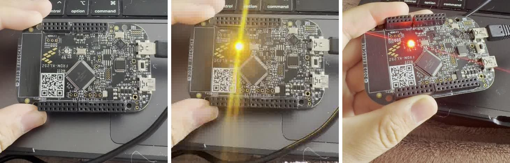
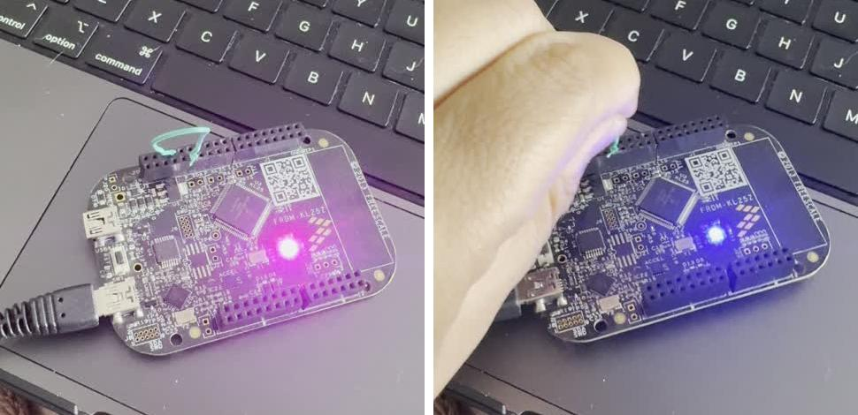

# Atividade — Threads e Prioridades

Placa FRDM-KL25Z com Zephyr 4.2, gravada pelo PlatformIO. O código está em [`src/main.c`](src/main.c) e os logs de cada teste estão na pasta [`logs/`](logs/).

## Como montei o experimento

Partindo do código fornecido na atividade (primeiro commit da branch `prioridades`), acrescentei algumas coisas para conseguir responder às perguntas. Cada thread passou a medir quanto tempo leva para fazer o seu trabalho, usando o contador do SysTick (`k_cycle_get_32()`, que conta ciclos de 48 MHz, ou seja, cerca de 20,8 ns por ciclo) e também o `k_uptime_get_32()`, que dá o tempo em milissegundos desde o boot. Com esses valores, cada thread imprime no log quando começou, quando terminou e quanto durou.

Para testar várias combinações sem ficar reescrevendo o código, criei uma macro `CASO` no início do arquivo. Mudando esse número, mudam as prioridades das threads e se a thread B dorme ou não. Também liguei um botão por interrupção no pino PTA16 e troquei todos os `printk` por Logging.

| LED | Quem controla | Prioridade padrão | Trabalho a cada ciclo | Tempo dormindo |
|---|---|---|---|---|
| Verde (`led0`) | Thread A | 5 | laço de 200 mil iterações | 1500 ms |
| Vermelho (`led2`) | Thread B | 7 | laço de 10 milhões de iterações | 1000 ms |
| Azul (`led1`) | ISR do botão | acima de todas as threads | inverte o LED | — |

Vale lembrar que no Zephyr o número menor é a prioridade maior, e que prioridades negativas são cooperativas.

## 1. Tempo de cada thread e diagramas temporais

A duração que cada thread mede é o tempo "de relógio" entre acender e apagar o LED. Por isso, se a thread for interrompida no meio do trabalho, o tempo em que ela ficou parada entra na conta. Comparar essas durações entre os casos é justamente o que mostra quem interrompeu quem.

Rodei na placa os casos 1, 2, 5 e 6. Os casos 3 e 4 ficaram só na previsão teórica.

| Caso | Duração de A | Duração de B | A interrompeu B? | Período real de A |
|---|---|---|---|---|
| 1 — A 5, B 7 | 50,08 ms | 14,55 s | Sim, 9 vezes por ciclo de B | 1559 ms |
| 2 — A 7, B 5 | 50,08 ms | 14,02 s | Não | cerca de 15 s |
| 5 — A 7, B 5, B sem `k_msleep` | nunca executou | 13,94 s | Não | A nunca roda |
| 6 — A 5, B cooperativa (-1) | 50,08 ms | 14,00 s | Não | cerca de 15 s |

A primeira coisa que chama atenção é que A sempre leva 50,08 ms, com variação menor que 20 µs. O trabalho dela é sempre o mesmo, então o que muda de um caso para o outro não é quanto tempo ela leva, e sim **quando** ela consegue executar.

No caso 1, B demora 530 ms a mais do que no caso 2 (14,55 s contra 14,02 s). Essa diferença é exatamente o tempo das 9 vezes em que A interrompeu B em cada ciclo, já que cada execução de A gasta uns 50 ms de trabalho e uns 9 ms imprimindo o log. Pelo mesmo motivo, o período de A fica em 1559 ms: 1500 ms dormindo, 50 ms trabalhando e 9 ms de log.

Outra coisa que só percebi por causa dos tempos intermediários do log: os dois primeiros blocos de 2 milhões de iterações de B levam cerca de 2,18 s cada, e os seguintes passam para 3,22 s. Isso acontece porque o Cortex-M0+ não tem instrução de divisão, então o `i % 2000000` é calculado por uma rotina de software, que fica mais lenta quando os números crescem.

*Fotos dos vídeos que gravei. À esquerda, caso 1 com B dormindo (LED apagado). No meio, caso 1 no instante em que A interrompe B: verde e vermelho juntos aparecem amarelos. À direita, caso 5, com o vermelho sempre aceso e o verde nunca acendendo.*

Os diagramas abaixo estão em escala de tempo. Nos casos medidos, usei os tempos dos logs.

### Caso 1 — A com prioridade 5 e B com 7 (código original), medido

Como A tem prioridade maior, sempre que ela acorda interrompe B na hora e executa. Isso acontece 9 vezes durante cada ciclo de B, e A nunca atrasa: roda certinho a cada 1559 ms. No LED isso aparece como uma piscada amarela rápida no meio do vermelho, porque B ainda não tinha apagado o LED quando foi interrompida.

### Caso 2 — prioridades invertidas (A 7, B 5), medido

Agora é B que tem prioridade maior. A acorda aos 1,55 s, mas fica pronta, esperando, até B terminar o laço e ir dormir. No log, a primeira execução de A só aparece aos 14 085 ms. Depois disso A executa uma única vez por ciclo, uns 8 ms depois de B dormir, e o período dela vai de 1,5 s para cerca de 15 s. Na placa, o verde só acende quando o vermelho apaga.

### Caso 3 — prioridades iguais (7 e 7), previsão

Com a mesma prioridade, uma thread não interrompe a outra. Quem está executando continua até dormir, e a outra espera na fila de prontas. No começo, A deve rodar primeiro porque foi criada antes (`a_tid` entra na fila antes de `b_tid`). O *time slicing* vem desligado por padrão; se fosse ligado, as duas iriam se alternar em fatias de tempo.

### Caso 4 — B sem `k_msleep()` e com prioridade menor (A 5, B 7), previsão

Mesmo sem dormir, B tem prioridade menor, então A continua interrompendo B a cada 1,5 s normalmente. A diferença é que B passa a ocupar todo o resto da CPU e a thread *idle* nunca roda.

### Caso 5 — B sem `k_msleep()` e com prioridade maior (A 7, B 5), medido

Aqui A nunca executa. Em 83 segundos de log não apareceu nenhuma linha de A, e no vídeo o verde não acende nenhuma vez. B tem prioridade maior e nunca libera a CPU, então A fica pronta para sempre. É o caso de inanição da pergunta 3.

### Caso 6 — B cooperativa (prioridade -1) e A com 5, medido

O resultado foi praticamente igual ao do caso 2: A só executou aos 14 060 ms e depois uma vez por ciclo. A diferença é o motivo. No caso 2, B tinha prioridade maior; aqui, B é cooperativa, e uma thread cooperativa não pode ser interrompida por nenhuma outra thread, qualquer que seja a prioridade. A só roda quando B decide liberar a CPU com o `k_msleep()`.

## 2. Sem `k_sleep()`, prioridades iguais e threads cooperativas

Se uma thread não tem `k_sleep()`, ela nunca entra no estado "dormindo" e fica sempre pronta para executar. O efeito depende da prioridade dela. Se ela tiver prioridade menor que as outras, como no caso 4, as outras continuam interrompendo normalmente e ela só ocupa o tempo que sobraria para a *idle*. Se tiver prioridade maior ou igual, como no caso 5, ela nunca solta a CPU, e as threads de prioridade menor ou igual nunca mais executam.

Quando as threads têm a mesma prioridade, executa primeiro a que estiver primeiro na fila de prontas. Aqui seria A, que foi criada antes. Sem *time slicing*, quem está executando só sai quando dorme ou bloqueia, e aí entra a próxima da fila.

As threads cooperativas têm prioridade negativa e só perdem a CPU quando querem: ao chamar `k_sleep()`, `k_yield()` ou ao bloquear esperando um semáforo, fila ou mutex. Nenhuma outra thread consegue interrompê-las, e o caso 6 mostrou isso na prática. Só interrupções de hardware conseguem, e mesmo assim, quando a ISR termina, a CPU volta para a mesma thread cooperativa (o teste da pergunta 4 confirmou isso). Isso é útil para trechos que não podem ser divididos, mas uma thread cooperativa longa atrasa todo o sistema.

## 3. Uma thread pode nunca ser executada?

Sim. Isso acontece quando uma thread de prioridade maior, ou cooperativa, fica sempre pronta e nunca bloqueia, como um laço sem `k_msleep()`. No caso 5, A nunca executou. Esse fenômeno é chamado de **inanição** (*starvation*).

É importante não confundir com a **inversão de prioridade**, que o livro-texto explica na seção 2.6 (p. 101–104). Na inversão, uma tarefa de alta prioridade fica bloqueada esperando um **recurso compartilhado** (um display, por exemplo) que está com uma tarefa de prioridade baixa. Uma tarefa de prioridade intermediária pode então passar na frente das duas. No nosso código as threads não compartilham nenhum recurso, então não existe inversão. O caso 5 é inanição pura: A não roda porque B nunca libera a CPU. Para a inversão, o livro cita como soluções a herança e o teto de prioridade, implementados no mutex, e o uso de uma tarefa *gatekeeper*, que centraliza o acesso ao recurso.

Para evitar a inanição, toda thread de prioridade alta precisa dormir ou bloquear em algum momento. Trabalhos longos devem ficar em prioridades baixas.

## 4. Interrupção de hardware (ISR)

A placa não tem botão de usuário, então liguei um fio entre o pino PTA16 (pino 9 do conector J2) e o GND (pino 14). O pino foi configurado com pull-up e interrupção na borda de descida. Quando o fio encosta, o pino vai para 0 V, a porta A pede uma interrupção ao NVIC, e a CPU salva o contexto da thread atual e pula para a `button_isr()`. A ISR inverte o LED azul e registra no log qual thread foi interrompida.

Fiz o teste no caso 6, que é o mais difícil para a ISR, porque B é cooperativa e nenhuma thread consegue interrompê-la. O log completo está em [`logs/caso6_isr.txt`](logs/caso6_isr.txt).

| O que medi | Resultado |
|---|---|
| Interrupções registradas | 10, em 6 toques do fio |
| Thread interrompida | `b_tid` em todas |
| Reação do LED azul | imediata, mesmo com B no meio do laço |
| Duração de B sem nenhum toque | 13 997,9 ms |
| Duração de B com 1, 2 e 3 interrupções | 14 006,3 ms · 14 014,8 ms · 14 023,6 ms |
| Toques que geraram 2 interrupções seguidas | 4 de 6, separadas por 9 a 18 ms |

*À esquerda, B executando (vermelho) com o azul aceso pela ISR, o que aparece como magenta. À direita, B dormindo, e o azul continua no estado em que a ISR deixou.*

O resultado mostra que a ISR fica acima de todas as threads, até da cooperativa: B estava no meio do laço, foi interrompida e depois continuou exatamente de onde parou. É o mesmo comportamento que o livro descreve para quando o escalonador está bloqueado (p. 106–107): a ISR executa imediatamente, mas ao final a CPU volta sempre para a tarefa interrompida. Em um núcleo preemptivo, se a ISR deixasse pronta uma thread de prioridade maior, a troca de contexto aconteceria na saída da interrupção. No Cortex-M, o Zephyr faz isso pela interrupção de software PendSV, que tem a menor prioridade, exatamente a estratégia da Figura 2.9 do livro (p. 101–102). Como no caso 6 a thread interrompida era cooperativa, a CPU sempre voltou para ela.

O livro separa o tempo de uma interrupção em três partes (p. 98–100): a latência, que vai do evento até o começo da ISR; a resposta, até o código que trata o evento; e a recuperação, que é a volta para o código interrompido. No meu teste a latência foi muito pequena, porque o LED muda na hora. Mas cada interrupção atrasou B em cerca de 8,5 ms, e quase todo esse tempo é o `LOG_INF` dentro da ISR. No modo imediato, a mensagem de uns 90 caracteres é enviada pela serial a 115200 bit/s ali mesmo, o que leva em torno de 8 ms, enquanto inverter o LED leva microssegundos. Durante esses 8 ms, outras interrupções de prioridade igual ou menor ficariam esperando, o que aumentaria a latência do sistema inteiro. Por isso a ISR deve ser curta. Deixei o log ali só para a demonstração; num sistema real, a ISR só sinalizaria um semáforo e o resto ficaria numa thread.

Também apareceu o repique do contato metálico: em 4 dos 6 toques, o fio gerou duas bordas de descida com 9 a 18 ms de diferença, e por isso o azul às vezes trocava duas vezes. Com um botão de verdade, seria preciso um *debounce*, por exemplo ignorando novas interrupções por uns 50 ms.

## 5. Logging, `printk`, `printf` e debug

Troquei os `printk` do código original por `LOG_INF`, com o módulo `prioridades`, e incluí os tempos intermediários da thread B, que mostram em que ponto do laço ela foi interrompida. Esses tempos foram o que me permitiu ver a lentidão da divisão no M0+ e calcular o custo de cada interrupção.

| Recurso | Como funciona | Vantagem | Desvantagem |
|---|---|---|---|
| `printk` | função do kernel que escreve direto na serial | simples, leve, funciona dentro de ISR | sem níveis nem filtros; ocupa a CPU enquanto envia |
| `printf` | função da biblioteca padrão do C | formatação completa, inclusive *float* | usa mais memória e é mais lento; não é indicado em ISR |
| Logging | subsistema do Zephyr com níveis (erro, aviso, info, debug) e módulos | dá para filtrar, tem carimbo de tempo e pode ser desligado sem custo | precisa de configuração; no modo *deferred*, depende de uma thread de log |
| Debug (GDB) | para o programa em *breakpoints* e mostra variáveis e registradores | mostra o estado exato sem mexer no código | parar a CPU altera os tempos, o que atrapalha justamente a análise de prioridades |

Usei o `CONFIG_LOG_MODE_IMMEDIATE=y`, em que a mensagem sai na hora, no contexto de quem chamou. A vantagem é que o log continuou aparecendo até no caso 5, em que uma thread de log de baixa prioridade passaria fome. A desvantagem é que isso aumenta um pouco as durações medidas, como vimos na ISR. No geral, achei o log mais útil para entender a sequência e o tempo das coisas, e o debugger mais útil para achar um erro de lógica num ponto específico do código. As duas ferramentas se complementam.
